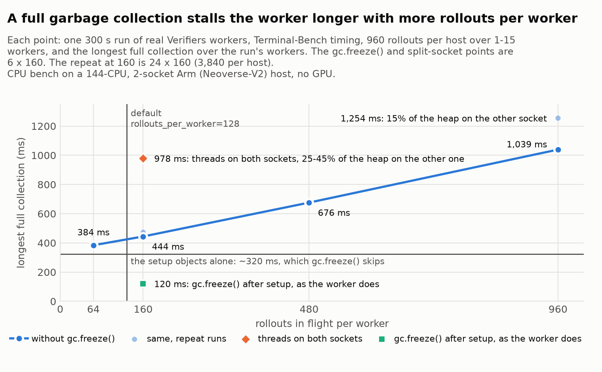
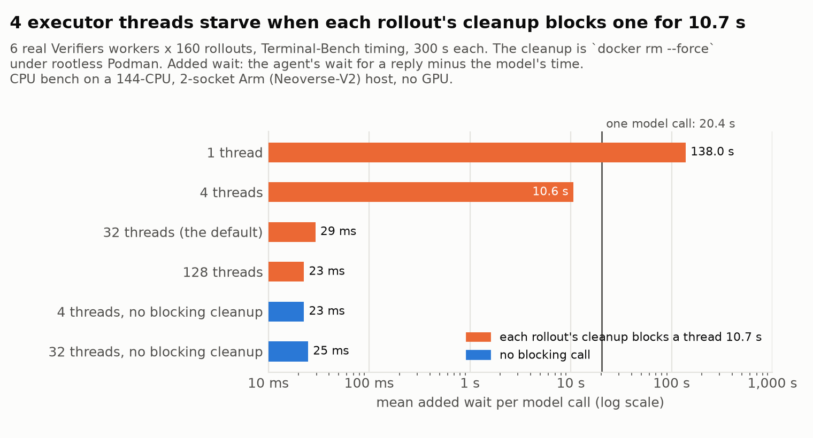

# Rollout workers: processes, threads and stalls

A rollout worker is one process that runs many rollouts at once. This page explains how one worker
runs, what limits it, how to size it for your env, and which metrics show trouble. The numbers come
from a CPU bench that runs the real worker code (see [How we measured](#how-we-measured)).
[`scripts/rl/rollout_worker_bench.py`](../../../scripts/rl/rollout_worker_bench.py) reruns three of
them in ~3 minutes on one Linux host: the thread counts, the executor wait under a blocking cleanup,
and the import-heap part of a full garbage collection, with and without `gc.freeze()`. Verifiers
workers have a few more pieces: see
[Inside a Verifiers rollout worker](../examples/verifiers/README.md#inside-a-verifiers-rollout-worker).

## In short

Measured reasons: CPU bench, Verifiers workers at Terminal-Bench timing, unless a cell says otherwise.

| Setting | Default | Change it when | Measured reason |
| --- | --- | --- | --- |
| `rollouter.rollouts_per_worker` | 128 | Keep it at 64-160 for agent envs (multi-turn, with tools and a sandbox). Lower it when `gc_pause_ms` reads hundreds of ms. | The worker's longest stall is a full garbage collection. The worker calls `gc.freeze()` after setup, so the collection skips the setup objects: 120 ms at 160 rollouts per worker. The rest grows with rollouts per worker. Without the freeze: 384 ms at 64, 444 ms at 160, 1,039 ms at 960. Each extra worker costs ~1.0-1.3 GiB of private memory (at 16-160 rollouts per worker). |
| `rollouter.num_threads_per_worker` | 32 | `executor_queue_wait_ms` reads seconds, well above `gc_pause_ms`, e.g. when your env blocks a thread for seconds per rollout. Size: busy threads = rollouts ending per second per worker x seconds blocked. Leave ~4x headroom when a few threads are busy, ~2x from ~10 busy up. | 6 workers x 128 rollouts, and each rollout's `docker rm --force` (rootless Podman) blocks a thread 10.7 s. Mean time the worker added to each model call: 4.3 s with 4 threads, 21 ms with 32. This page's script measures only each render's wait for a thread (128 running rollouts per worker): 1.9 s mean with 4 threads, 1 ms with 32. |
| `OMP_NUM_THREADS` | 1 in each worker | Leave it. | Insurance. In the bench, a worker never ran a torch op big enough to start torch's thread pool. The setting stops numpy's 63 idle threads. |
| `TOKENIZERS_PARALLELISM` | unset | Leave it, or set `false`: both are safe. | The tokenizers library's pool never runs work in a worker. It holds ~18 MiB, 1.3% of a worker's memory, and neither setting changes render speed. |

To spot a worker in trouble, watch `rollout_worker/event_loop_lag_ms`: the longest time its event loop
couldn't run. `rollout_worker/gc_pause_ms` tells a garbage collection from other stalls. In a Verifiers
worker at 160 rollouts per worker, the longest collection took ~0.1 s (CPU bench).
`rollout_worker/executor_queue_wait_ms` shows calls waiting for an executor thread, which the loop lag
misses. When a default doesn't fit your env,
[Which metric shows which gap](#which-metric-shows-which-gap) says which metric shows it and what to
change.

## How one worker runs

### The process

The controller starts `ceil(training rollouts in flight / rollouts_per_worker)` workers
(`torchtitan/rl/controller/controller.py:588-604`) and spreads them over the hosts that
`rollouter.worker_roles` picks (`RolloutWorkerRoles` in [`rollouter.py`](rollouter.py)). Example:
48 groups x 32 rollouts = 1,536 rollouts in flight. 1,536 / 128 = 12 workers. A group must fit in one
worker (`controller.py:433-438`).

Two counts this page keeps apart:

- **Rollouts in flight** on a worker: what `rollouts_per_worker` counts. A rollout counts from the
  moment its group is sent until the whole group returns, so a finished rollout that waits for the
  rest of its group still counts (`torchtitan/rl/rollout/rollouter.py:392-394`).
- **Running rollouts**: the ones still calling the model or a tool. In the bench, 160 rollouts in
  flight per worker meant ~63 running.

Each worker is its own Monarch process. Monarch is the actor framework TitanRL runs on. It runs
`apply_rollout_worker_env_defaults` in each worker before torch loads
(`torchtitan/rl/actors/monarch/system.py:234-237`, `torchtitan/rl/_env.py:40-48`).

### Inside the process

```text
one rollout worker process
├─ event loop: 1 thread      every rollout's Python code, one step at a time:
│                            env steps, HTTP, JSON, Monarch calls, metrics
├─ executor:                 blocking work handed off with asyncio.to_thread:
│  num_threads_per_worker    renders (chat messages -> token ids), sandbox and file calls
└─ idle library threads      Monarch's runtime (~70-150, sized to the CPUs),
                             the tokenizers library's pool (1 per CPU, Verifiers workers only)
```

Terms the rest of the page uses:

- **Event loop.** One thread runs the code of every rollout. A rollout runs until it waits (for the
  model, for a tool), then the loop runs another one. Code that runs long without an `await` holds
  every rollout of the worker.
- **GIL.** Python's global lock: only one thread runs Python code at a time in a process. Native code
  (Rust, C) can release it. So more threads don't run more Python code. More processes do.
- **Executor.** The thread pool behind every `asyncio.to_thread` call in the process. The worker sets
  its size to `num_threads_per_worker` (`torchtitan/rl/actors/monarch/rollout_worker.py:49-54`).
- **Full garbage collection (GC).** Python frees most objects as soon as nothing points to them
  (reference counting). A separate collector finds groups of objects that point at each other. Its
  full collection walks every tracked object in the process, and the event loop runs nothing until it
  ends.
- **Private memory.** The memory only this process maps (USS): what the host gets back when the
  worker exits.

### One model call, step by step (a Verifiers worker)

Example: a Verifiers worker at Terminal-Bench load (CPU bench, 6 workers x 160 rollouts, medians of
3,389 calls). The agent runs in its sandbox and calls the worker over HTTP.

| Step | Runs on | Time (p50) |
| --- | --- | --- |
| 1. The agent sends its chat to Verifiers' interception server, in the worker. Verifiers' train client (the code that turns the chat into a generate request) renders the new messages to token ids on an executor thread (2.2 ms at ~12K-token prompts). Then it sends them to the worker's `GenerationServer` over loopback HTTP. | event loop, 1 executor thread | 8.2 ms |
| 2. `generate_fn` asks the generator router (it picks a generator for each request) for a generator, then sends it the prompt, over Monarch (`controller.py:713-748`). | event loop | 3.6 ms |
| 3. The generator decodes the reply. | GPU | ~20,400 ms (mean in the Terminal-Bench training run the workload mirrors) |
| 4. The completion comes back over Monarch. | event loop | 2.4 ms |
| 5. The `GenerationServer` answers, and the interception server sends the agent its reply. | event loop | 5.1 ms |

The worker adds ~20 ms to each model call (p50 19.8 ms, p99 70 ms), 0.1% of a 20.4 s call. At this
load, a worker's own work is noise next to the model and the tools. The rest of the page is about
when it stops being noise.

A native worker (`MessageEnvRolloutWorker`) skips the HTTP of steps 1 and 5: it calls `generate_fn`
directly, and renders and parses on the executor (`token_env.py:203-211`, `:268`). It used ~4 ms of CPU per
model call at ~240 calls/s (CPU bench, DAPO Math, one turn).

## What scales and what doesn't

**One event loop has a limit.** One Verifiers worker fills a CPU core at ~55 model calls/s, ~18 ms of
CPU per call (Terminal-Bench rollouts replayed with model and tool times divided by 10). A native
worker (DAPO Math, one turn, ~1 s generations) reaches ~240 calls/s, ~4 ms of CPU per call. A
Terminal-Bench worker makes ~2.2 calls/s, ~4% of its limit. An env that needs more: more workers, i.e.
a lower `rollouts_per_worker`.

**More workers per host don't add throughput, but shorten the slowest calls (p99).** The same 960
rollouts per host, split over more workers (CPU bench, Terminal-Bench timing, one 300 s run each, all
workers on one socket, no `gc.freeze()`):

| Workers x rollouts each | Model calls/s per host | Added per call, p50 / p99 | Longest full GC | Private memory per host |
| --- | --- | --- | --- | --- |
| 1 x 960 | 13.9 | 23 / 898 ms | 1,039 ms | 2.9 GiB |
| 2 x 480 | 13.7 | 21 / 455 ms | 676 ms | 3.9 GiB |
| 6 x 160 | 13.1 | 20 / 70 ms | 444 ms | 7.9 GiB |
| 15 x 64 | 13.8 | 18 / 42 ms | 384 ms | 16.9 GiB |
| 60 x 16 | 14.4 | 19 / 38 ms | none in 300 s | 60.8 GiB |

- Throughput stays the same: the model and tool times set it, and every worker has spare loop time.
- The slowest calls get slower with more rollouts per worker. A worker that holds more rollouts has
  more objects, so each full collection takes longer, and every model call in flight on that worker
  waits for it.
- Memory grows with workers. Each holds ~1.0-1.3 GiB of private memory at 16-160 rollouts per worker,
  mostly imported libraries and one renderer. The `rollouts_per_worker` docstring says ~0.8 GiB after
  setup (`rollouter.py:165`), before any rollout runs.

**More threads in one worker don't run more Python.** Renders of a whole 8K-token chat, each thread
with its own Qwen3.5 renderer: 2.3x the renders per second of one thread at 4 threads, 2.5x at 8, 2.2x
at 16. The same renders in 16 processes: 15.8x (CPU bench, 48 CPUs, median of 3 runs). About a
quarter of a render is Python code, and all threads of a process share one GIL.

**A faster event loop didn't help.** uvloop is an event loop written in C. In the bench, a bootstrap
that set uvloop's event loop policy made the worker's running loop a uvloop loop (checked in the
worker). uvloop gained nothing on the native path (within the spread of two asyncio runs). It used
25-40% more CPU per model call on the Verifiers path (one run). The worker uses asyncio's default
loop, and TitanRL has no setting for it.

## The settings

### `rollouts_per_worker`

Default 128 (`torchtitan/rl/rollout/rollouter.py:161`). It sets the most training rollouts in flight
on one worker, so the number of workers.



- A full collection has two parts. In a Verifiers worker, about 320 ms walks the ~1M objects that the
  worker's imports and setup create: functions, tuples and dicts of torch, Verifiers and the other
  libraries (~210 ms without Verifiers' imports, this page's script). The rest grows with the rollouts
  the worker holds: their messages, token ids and request state.
- The worker removes the first part. At the end of its setup, it calls `gc.freeze()`
  (`torchtitan/rl/actors/monarch/rollout_worker.py:92-99`), which moves every object alive at that
  moment out of the collector's reach. The graph's line and the rest of this list were measured
  without it.
- Python's collector sorts objects into three generations, by how many collections they survived. The
  oldest holds long-lived objects, such as the ~1M from imports. Python 3.12 starts a full collection
  once the objects added to the oldest generation since the last full collection reach 25% of its size
  ([CPython `gcmodule.c`](https://github.com/python/cpython/blob/v3.12.16/Modules/gcmodule.c#L1478-L1480)).
  So more rollouts per worker, or more model calls per second, give both longer and more frequent full
  collections.
- The default 128 sits between 64 (384 ms) and 160 (444 ms). At 480 rollouts per worker, full
  collections reach ~0.7 s. At 960, they pass 1 s: three runs gave 1,039, 1,049 and 1,254 ms, the last
  with 15% of its heap on the other socket.
- Going lower buys little: from 160 to 64 rollouts per worker, the p99 added time per call drops from
  70 to 42 ms, and the host needs 2.5x the workers, ~1 GiB each.
- The pause depends on rollouts per worker, not per host: 24 workers x 160 rollouts (4x the host load)
  paused like 6 x 160 (447 vs 433 ms, median full collection).

What `gc.freeze()` after setup changed in the bench:

- At Terminal-Bench load (6 workers x 160 rollouts): the longest full collection went from 461 to
  120 ms, and each worker's worst loop stall from 421-452 to 81-119 ms. Full collections came 4.5x as
  often (4 -> 18 over the 6 workers in 300 s). The total pause, the mean added time per call (21.6
  vs 22.0 ms), calls per second and memory stayed the same. The p99 added time went from 47 to 56 ms
  (one run each).
- Near a loop's limit (1 worker x 256 rollouts, Terminal-Bench replay at 10x): the worst pause went
  from 549 to 233-488 ms (two runs). Full collections came 3.5-4x as often, and the total pause grew
  30-50%. One 488 ms pause was not explained.
- Full collections come more often because the 25% rule above compares against the objects the last
  full collection kept, and frozen objects are no longer among them
  ([CPython `gcmodule.c`](https://github.com/python/cpython/blob/v3.12.16/Modules/gcmodule.c#L1255-L1257)).
- The trade-off: setup objects that later become garbage are never freed. TitanRL's SGLang engine
  freezes for the same reason (`torchtitan/rl/generator/sglang/engine.py:346-350`).

Sizing rule for agent envs: 64-160 rollouts per worker. The full-collection pause sets the top, the
memory per worker sets the bottom. The range was measured without the freeze. The freeze removes only
the setup part, so the pause still grows with rollouts per worker.

### `num_threads_per_worker`

Default 32 (`rollouter.py:170`). It sets the executor's size.

Who uses the executor:

| Caller | How often | Time each |
| --- | --- | --- |
| Render of the next prompt. Native workers also parse each reply and build each prompt there ([`token_env.py`](token_env.py)). | every model call | 2.2 ms (median, Verifiers, ~12K-token prompts) |
| Sandbox cleanup at the end of a rollout | once per rollout | 0.5 ms (a local process), 10.7 s (`docker rm --force` under rootless Podman) |
| Address lookup of Verifiers' egress proxy (local Docker: one proxy per sandbox, it forwards the agent's requests to the worker) | every model call | <1 ms |

How it fails: a call that blocks for seconds holds a thread the whole time. When every thread is held,
each render waits, so each model call waits. The event loop is free meanwhile, so
`event_loop_lag_ms` doesn't show it. `executor_queue_wait_ms` does (see
[Which metric shows which gap](#which-metric-shows-which-gap)).



Why 4 threads starve, by Little's law (threads busy = rate x time each). The bench ran 160 rollouts in
flight per worker:

1. Rollouts ended at 0.32 per second per worker (96 in 300 s). So each stayed in flight ~500 s on
   average (160 / 0.32), running or waiting for the rest of its group.
2. Each cleanup holds a thread 10.7 s: 0.32 x 10.7 = 3.4 threads busy on average.
3. Renders add 2.2 per second (one per model call) x 0.0022 s each = 0.005 threads.
4. 3.4 of 4 on average means bursts take all 4, and renders queue behind the cleanups.

At the default 128 rollouts in flight (6 workers x 128, one run per thread count), worker 0's rollouts
ended at 0.22 per second: 0.22 x 10.7 = 2.4 threads busy on average. Bursts held all 4 threads 39-55%
of the time, depending on the worker. Model calls waited 4.3 s more on average (26.7 s at p99). With
32 threads: 21 ms, about what a worker adds with no blocking call. This page's script has no groups,
so its 128 rollouts are all running and end faster: 2.9 busy threads, and renders waited 1.9 s on
average (one run).

Sizing rule: busy threads on average = rollouts ending per second per worker x seconds each rollout
blocks a thread. Bursts fill more, so leave ~4x headroom when a few threads are busy, ~2x from ~10 busy
up. These margins are not measured: the bench ran 1, 4, 32 and 128 threads. It does show that a small
margin fails: at the default 128 rollouts per worker, 2.4 threads were busy on average, and 4 threads
(1.7x) left model calls waiting 4.3 s. At 160 rollouts per worker, 4 x 3.4 = ~14, so 32 leaves room. In
a run, `num_executor_jobs_in_flight` gives an upper bound: it counts the calls waiting for a thread
too, so the load needed at most that many threads. With no blocking call, 4 threads are enough. At
Terminal-Bench load, 99% of renders waited 4 ms or less. On the native path at ~240 calls/s, 4 threads
added 11 ms per group over 32 (72.7 vs 61.4 ms, p50).

What 32 threads cost: each started thread holds ~4 MiB of private memory (1,223 vs 1,341 MiB per
worker with 4 vs 32 threads, same load). Python's pool starts a thread only when none is idle
([CPython `thread.py`](https://github.com/python/cpython/blob/v3.12.16/Lib/concurrent/futures/thread.py#L184-L187)),
so a quiet worker starts fewer.

### `OMP_NUM_THREADS`

Default 1 in each worker. It sets the size of torch's OpenMP thread pool and of numpy's OpenBLAS pool,
the threads that split one math op across CPUs. Unset, each pool takes one thread per CPU (OpenBLAS:
at most 64). Each worker's bootstrap sets it to 1, unless the variable is already set when the process
starts (`torchtitan/rl/_env.py:40-48`).

Threads in a fresh process after each step (script output, 72 CPUs):

| Environment variables | Start | `import numpy` | `import torch` | 256x256 matmul | `torch.get_num_threads()` |
| --- | --- | --- | --- | --- | --- |
| `OMP_NUM_THREADS` unset | 1 | 64 | 64 | 135 | 72 |
| worker bootstrap (`OMP_NUM_THREADS=1`) | 1 | 1 | 1 | 1 | 1 |

- `import numpy` starts OpenBLAS's pool: 63 threads (its cap is 64).
- Torch's OpenMP pool starts only at the first op big enough to split: +71 threads here.

In the bench's Verifiers worker (144 CPUs, `OMP_NUM_THREADS` unset), no thread started during rollouts besides
the executor and the tokenizers library's pool. So no rollout ran such a torch op, and torch's pool
never started. TitanRL's rollout code (`torchtitan/rl/rollout/`) runs no torch op: its one torch
import is `Stateful`, a base class for checkpoint state (`data.py:16`). Image envs don't change this:
the worker's renderer reads the image file and decodes only its header, no pixels
(`torchtitan/models/qwen3_5/renderer.py:123-126`), and prompts carry the file's bytes
(`torchtitan/rl/rollout/types.py:45-77`).

So the setting is insurance. It costs nothing today, since no worker runs torch math. It stops
63 OpenBLAS threads that sit idle (their memory was not measured). And it caps torch's pool if an env
runs torch math in the worker, which then runs on 1 core (`_env.py:43-45`).

Still open: the other RL processes. The controller, trainer and generators don't set
`OMP_NUM_THREADS` (`RL_ENV_DEFAULTS` at `torchtitan/rl/_env.py:16-23`), and this page didn't measure
them.

### `TOKENIZERS_PARALLELISM`

Default: unset. A render's tokenizer call is `encode_batch`, even for one text
(`transformers==5.22.1 transformers/tokenization_utils_tokenizers.py:1072-1076`). The first one starts
the tokenizers library's pool: 144 threads on a 144-CPU host, in every Verifiers worker (CPU bench).
In a run with 128 rollouts per worker, those threads used no CPU. The work ran on the calling thread, which
releases the GIL meanwhile (`tokenizers==0.23.3 bindings/python/src/tokenizer.rs:1312-1340`). The
pool holds ~18 MiB, 1.3% of a worker's memory. With the variable set to `false`, renders are as fast
(2K / 64K tokens: 3.19 / 115.6 ms vs 3.31 / 121.4 ms with the pool). So both settings are safe, and
18 MiB is too little to need a default. Native workers call `encode` and never start the pool.

## Metrics

What each metric shows and when to act:
[Rollout worker metrics](../observability/metrics/README.md#rollout-worker-metrics).

### Which metric shows which gap

The defaults won't fit every env. When one doesn't, this is where it shows (values from the CPU
bench):

| Gap | What you see | What to change |
| --- | --- | --- |
| Long garbage-collection stalls | `gc_pause_ms` in the hundreds of ms, and `event_loop_lag_ms` about as long. In the bench, the longest full collection at 160 rollouts per worker was 120 ms with `gc.freeze()`. Without it: ~0.45 s at 160, ~1 s at 960, 978 ms at 160 when the worker's threads ran on both sockets. `num_rollouts_in_flight_max` shows where on the graph above the busiest worker sits. | Lower `rollouts_per_worker`. On a 2-socket host, check where the workers' memory sits (`/proc/<pid>/numa_maps`). |
| A loop near its limit | `event_loop_lag_ms_per_s` climbs. Verifiers worker: 23 ms/s at 2.2 model calls/s (~4% of its limit), 86 at 29 calls/s, 339 at 55 calls/s (full). Native worker: 24 ms/s at 58 calls/s, 83 at 240 calls/s (full). | More workers: lower `rollouts_per_worker`. |
| Too few executor threads | `executor_queue_wait_ms` reads seconds, well above `gc_pause_ms`, and `num_executor_jobs_in_flight` reads above `num_threads_per_worker`. In the bench (6 workers x 128, a 10.7 s blocking cleanup per rollout), the longest wait for a thread was 17-34 s per worker with 4 threads, 4-18 ms with 32 (over 300 s). `event_loop_lag_ms` stays at its usual size: at 160 rollouts per worker with 4 threads, it read 371 ms (a full collection) while model calls waited ~10 s for a thread. | Raise `num_threads_per_worker` to about `num_executor_jobs_in_flight` (sizing rule above). Then check that the wait drops to tens of ms. |
| Memory growth | `rss_gib` still rising after many steps at the same load. `pss_gib` x the workers on a host is an upper bound of their memory there. | Fewer workers per host, or find what the env keeps. |

Checks behind these rows:

- A 500 ms `time.sleep` on a worker's loop read 476 ms. Two full collections of 583 and 604 ms read 562
  and 598 ms.
- `event_loop_lag_ms_per_s` read 16-21 ms/s in groups with no stall over 21 ms. Its value depends on
  the 50 ms sampling interval: a 10 ms sampler read 66 ms/s in the same window.
- 128 threads, each on its own CPU, each touching 16 MiB: `ru_maxrss` read 18 MiB while `VmRSS` read
  2,069 MiB (Linux 6.16, 64 KiB pages). The kernel keeps RSS in per-CPU counters, which `getrusage`
  reads before they are folded in (inference from these numbers). A 1,024 MiB allocation on one thread
  of a worker did show (+1,008 MiB). So the worker reads `VmRSS` and `Pss` from `/proc` when each group
  returns (`rollout_worker.py:136-145`), and not the peak from `getrusage`.
- The `_per_s` values in the table are each run's mean over the groups it returned (one run per row).

## Not in the code yet: each worker on one socket

TitanRL starts rollout workers without binding them to a socket. On a 2-socket host, that slows their
garbage collections. Linux puts a memory page on the socket of the CPU that first touches it, and a
full collection follows millions of pointers. In the CPU bench (no `gc.freeze()`):

- Workers whose threads ran on both sockets of the bench host paused 1.75x longer (median full
  collection ~870 vs ~495 ms) and used 26% more loop CPU per model call. Near a loop's limit (native,
  ~240 calls/s), they lost 7% of their throughput.
- Workers started as TitanRL starts them, with no binding, were close to that case. Each worker's loop
  thread ran about half the time on each socket, and its heap was split 28-48% / 52-72% between them.
  Binding each worker's CPUs and memory to one socket (`numactl --cpunodebind=N --membind=N`) cut the
  median full collection from 769 to 430 ms, 1.8x (6 workers x 160 rollouts each way). The bound and
  unbound workers ran side by side on one host, so both saw the same load.
- Pinning CPUs alone wasn't enough. When the worker's own socket was short of free memory, 27% of a
  worker's heap landed on the other socket, so a fix binds memory too.

The binding is a `TODO` in the code, above the workers' `spawn_procs` call
(`torchtitan/rl/actors/monarch/system.py:231-233`). Monarch's `spawn_procs` takes a binding for each
process (`proc_bind`, `torchmonarch==0.7.0 monarch/_src/actor/host_mesh.py:108-122`). It waits for a
check on a real generator host.

## How we measured

The CPU bench runs the real worker code with fakes where a GPU or a sandbox would be:

- Real:
  - `RolloutWorkerActor`, with its setup, `run_group` and metrics.
  - `VerifiersRolloutWorker` with Verifiers 0.4.1: interception servers, train client, the Qwen3.5
    renderer from renderers 0.2.0, and the local process runtime.
  - The generate path through Monarch, with the real generator router.
- Fake: the generator sleeps time-to-first-token + tokens x 36 ms and returns a real completion's
  token ids. Each agent is a small process that replays a recorded Terminal-Bench rollout over HTTP.
  Its tool calls, sandbox start (13 s) and scoring (6 s) are sleeps.
- Workload, mirroring a Terminal-Bench training run: 15.9 turns per rollout, 568 completion tokens and
  529 tool-output tokens per turn, 20.4 s per model call, 6.1 s per tool call. Each worker keeps a
  fixed number of groups of 16 in flight. A finished group is replaced at once.
- "Added" time per model call: the agent's wait for a reply minus the model's time.
- The bench ran an earlier version of the worker code: 32 executor threads unless a row says
  otherwise, no `gc.freeze()` unless a row says so, and none of the executor-wait or GC-pause metrics.
  It timed the executor waits and the collections itself.
- Host: a shared 144-CPU, 2-socket Arm (Neoverse-V2) host, no GPU, Python 3.12, Linux 6.16. Each run's
  workers, fakes and agents had their own CPUs, on one socket unless a row says otherwise. One run per
  setting, unless a repeat is listed. Container numbers are rootless Podman 5.8.5. Docker itself
  wasn't measured.
- Not measured: a generator host, where the inference engine shares the CPUs with the workers.

### Rerun the key numbers

[`scripts/rl/rollout_worker_bench.py`](../../../scripts/rl/rollout_worker_bench.py) needs no GPU. It
needs the RL setup in [Prerequisites](../README.md#prerequisites) (the install script and
`PYTHONPATH`), and Verifiers for its default imports (or `--gc-imports
torchtitan.rl.actors.monarch.rollout_worker`). It reuses the worker's bootstrap, the worker's imports
and its metric classes (`EventLoopLag`, `QueueWaitThreadPoolExecutor`, `GcPause`). Generation, tools
and sandboxes are sleeps, with the workload above as a table in the script. Keep it on one socket:

```bash
numactl --cpunodebind=0 --membind=0 python scripts/rl/rollout_worker_bench.py
```

Output on the bench host (72 CPUs of one socket, 3 min):

```text
72 CPUs, Python 3.12.16

== threads: a fresh process's threads after each step ==
environment variables              start  import numpy  import torch  256x256 matmul  torch threads
OMP_NUM_THREADS unset                  1            64            64             135             72
worker bootstrap (OMP=1)               1             1             1               1              1

== executor: 4 threads, 128 running rollouts per worker, each sandbox cleanup blocks a thread 10.7 s ==
rollouts ending per s: 0.27 -> threads busy with cleanups (Little's law): 2.9 of 4
render wait for a thread: mean 1,921 ms, p50 1 ms, p99 15,251 ms (mean = 9% of a 20,400 ms model call)
the worker's executor metrics (real time, not scaled): executor_queue_wait_ms/max 4,050 ms (any job), num_executor_jobs_in_flight/max 92
event_loop_lag_ms/max: 2 ms (real time, not scaled)

== executor: 32 threads, 128 running rollouts per worker, each sandbox cleanup blocks a thread 10.7 s ==
rollouts ending per s: 0.30 -> threads busy with cleanups (Little's law): 3.2 of 32
render wait for a thread: mean 1 ms, p50 1 ms, p99 3 ms (mean = 0% of a 20,400 ms model call)
the worker's executor metrics (real time, not scaled): executor_queue_wait_ms/max 5 ms (any job), num_executor_jobs_in_flight/max 11
event_loop_lag_ms/max: 15 ms (real time, not scaled)

== gc: one full collection, after importing torchtitan.rl.actors.monarch.rollout_worker, torchtitan.rl.examples.verifiers.rollouter ==
rollouts per worker   gc.collect() ms   gc_pause_ms/max   event_loop_lag_ms/max   tracked objects
                  0               353               353                     353           954,097
                 64               335               335                     336           956,541
                160               344               344                     344           960,065
                480               387               387                     387           971,209
                960               452               452                     452           988,157
-- gc.freeze() after the imports, as the worker does after setup --
                  0                 0                 0                       0                50
                 64                10                10                      10             2,494
                160                22                22                      22             6,018
                480                62                62                      62            17,162
                960               128               128                     128            34,110
```

What it reruns, next to the bench:

- **Threads.** The same steps on 144 CPUs gave 1 / 64 / 64 / 207 threads unset: torch's pool takes one
  thread per CPU the process may use.
- **Executor.** The script divides every duration by 10, then multiplies the render waits back by 10,
  so they read in Terminal-Bench time. Its rollouts are all running (no groups). At 128 of them, 2.9 of
  4 threads are busy, and renders waited 1.9 s on average (the run above). With
  `--executor-rollouts-per-worker 160`, 3.8 of 4 were busy and renders waited 6.4 s on average (one
  run). In the bench, at 3.4 busy, this wait made up most of the 10.6 s added to each model call. 32
  threads: 1 ms.
- **The executor metrics.** The script prints them as the worker logs them, in real time.
  `executor_queue_wait_ms` read 4.05 s with 4 threads: the wait behind the cleanups, which run 10x
  faster than in Terminal-Bench, so it is ~10x longer there. With 32 threads it read 5 ms: a thread was
  free, and 5 ms is how long it took to start the call, which doesn't scale.
  `num_executor_jobs_in_flight` read 92 and 11. With 4 threads it also counts the renders queued
  behind the cleanups, so it is an upper bound on the threads needed.
- **The import heap's full collection.** The imports alone take 310-353 ms over four runs, as the real
  worker's setup did (321-328 ms on ~956K objects). `gc.freeze()` removes that part. `gc_pause_ms`
  read the same as the timed `gc.collect()` in every row.
- **Memory on the other socket.** `numactl --cpunodebind=0 --membind=1 ... --tests gc` gave 758 ms for
  the imports vs 314 ms with `--membind=0`: 2.4x.

What it doesn't rerun: how real rollouts grow the pause. The script's stand-in rollouts (each turn's
messages and token ids as Python lists) add ~100-130 ms at 960 rollouts per worker (four runs),
against about +700 ms in the bench. We did not find why.

To measure your own env's import heap, pass its modules:
`--tests gc --gc-imports torchtitan.rl.actors.monarch.rollout_worker my_project.my_env`.
